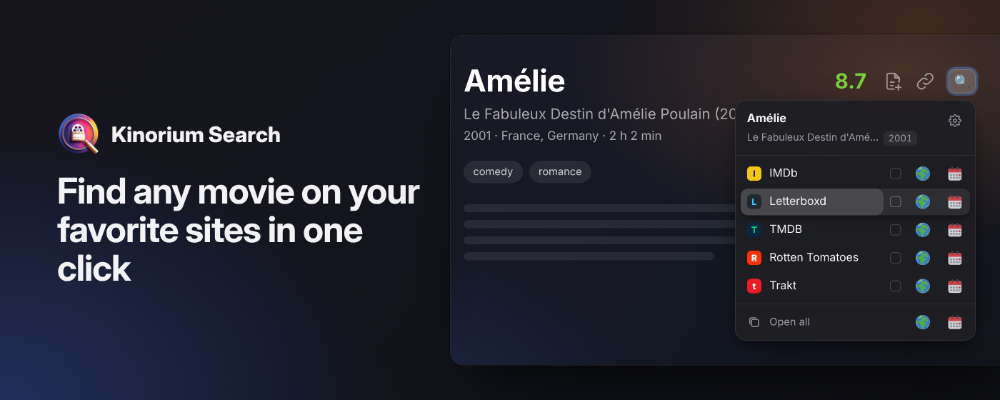
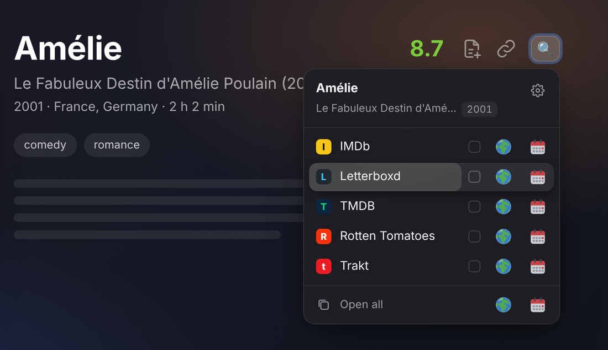
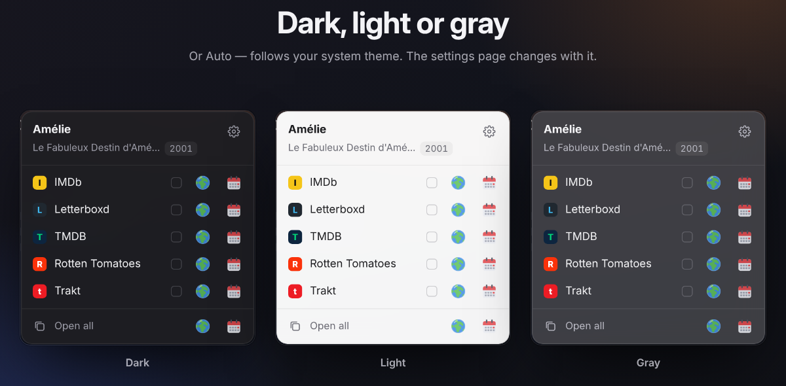
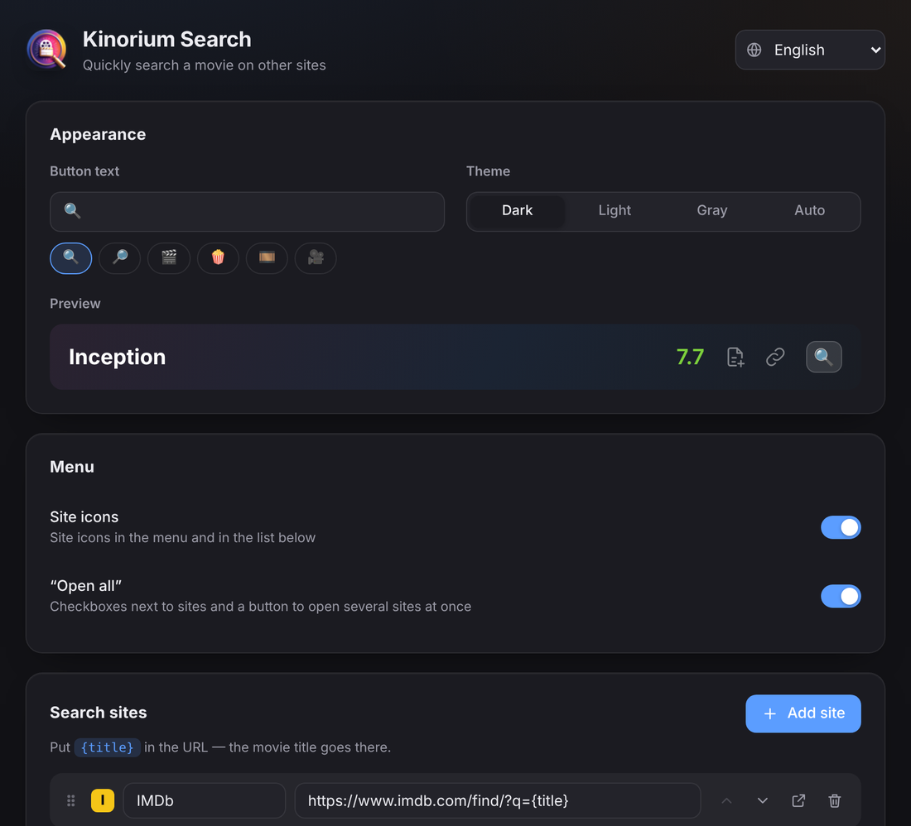

<!--
  After publishing, replace every CHROME_WEB_STORE_URL in README.md, README.ru.md and README.uk.md
  with the store link, e.g. https://chromewebstore.google.com/detail/kinorium-search/<EXTENSION_ID>
  Optional live badges (replace <EXTENSION_ID> and put them next to the Install badge):
  
  
  
-->

  

  

  <b>English</b> &nbsp;|&nbsp; <a href="README.ru.md">Русский</a> &nbsp;|&nbsp; <a href="README.uk.md">Українська</a>

  Find any movie from <b>Kinorium</b> on your favorite sites — in one click.

---

## About

**Kinorium Search** adds a neat search button right next to the movie title on Kinorium film pages. Click it and search the film on IMDb, Letterboxd, TMDB, Rotten Tomatoes or any other site you add — no more copying titles and switching tabs.

## Features

- **Three ways to search**
  - site name — by the title shown on the page;
  - 🌍 — by the original title (best for IMDb, Letterboxd and foreign sites);
  - 📅 — original title + year, for exact matches with remakes and namesakes.
- **Open several sites at once.** Tick the sites you need and open them in background tabs with one click. Nothing ticked — all sites open.
- **Any sites.** Put `{title}` into a search URL, and the site is added. Popular sites can be added in one click.
- **Handy settings.** Drag & drop ordering, a test button for each link, autosave, export and import.
- **Your look.** Dark, light, gray or automatic theme, your own button text or emoji; site icons and “Open all” can be turned off.
- **Three languages.** English, Ukrainian, Russian.
- **Private.** No data collection, no ads, no analytics.

## Screenshots

  
  

  

  

## Installation

### From the Chrome Web Store
Open the [extension page](CHROME_WEB_STORE_URL) and click **Add to Chrome**.

### Manually (developer mode)
1. Download this repository: **Code → Download ZIP**, then unpack it.
2. Open `chrome://extensions` and turn on **Developer mode** (top right).
3. Click **Load unpacked** and select the folder that contains `manifest.json`.

Works in Chrome and other Chromium-based browsers (Edge, Brave, Opera, Vivaldi).

## How to use

1. Open any film page on [Kinorium](https://en.kinorium.com/).
2. Click the 🔍 button next to the title.
3. Pick a site — the search opens in a new tab.

**Tips**
- Middle-click or <kbd>Ctrl</kbd>+click opens a site in a background tab and keeps the menu open.
- Hover over a title in the menu to copy it.
- <kbd>Esc</kbd> closes the menu.
- Click the extension icon in the toolbar to open the settings.

## Adding your own site

1. Search for anything on the site you want.
2. Copy the address of the results page.
3. Replace your query in it with `{title}`.

| Site | URL |
|---|---|
| IMDb | `https://www.imdb.com/find/?q={title}` |
| Letterboxd | `https://letterboxd.com/search/films/{title}/` |
| TMDB | `https://www.themoviedb.org/search?query={title}` |

You don't need to add the year: the 📅 button appends it to the title automatically.

## Permissions

| Permission | Why it's needed |
|---|---|
| `storage` | Save your settings and sync them between your devices |
| `favicon` | Show site icons from Chrome's own cache |
| Access to `ru./ua./en.kinorium.com` | Read the title and year from the film page and add the button |

## Privacy

The extension doesn't collect, send or sell any data. Details: [PRIVACY.md](PRIVACY.md).

## Changelog

### 1.1.0
- New look for the menu and the settings page
- Original title and year shown in the menu, copy in one click
- Open several selected sites at once
- Site icons, gray and automatic themes
- Popular sites in one click, drag & drop, link test, autosave
- Options to hide site icons and “Open all”
- Safer settings import, plus fixes for several bugs

## License

<!-- Add a LICENSE file (for example, MIT) and update this section. -->
See [LICENSE](LICENSE).

---

Kinorium Search is an independent project and is not affiliated with Kinorium.

<!--
  После публикации замените все CHROME_WEB_STORE_URL ссылкой на страницу в магазине.
  Живые бейджи — см. комментарий в начале README.md.
-->
