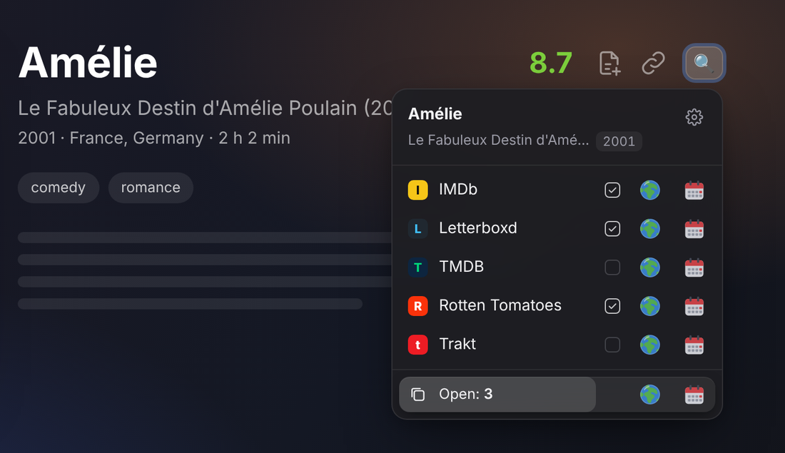
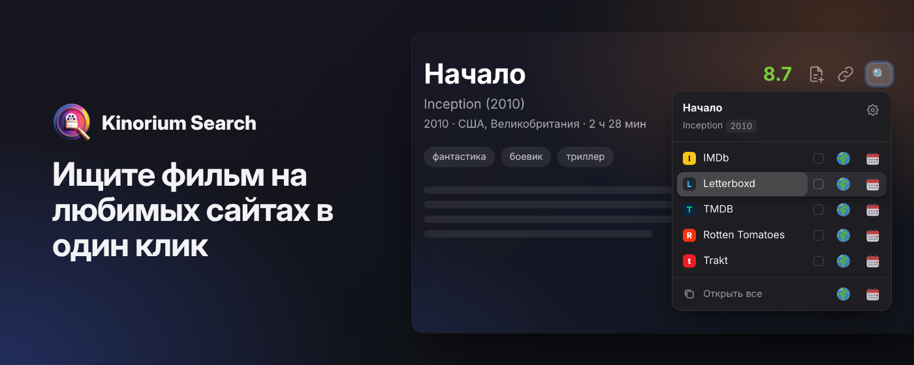
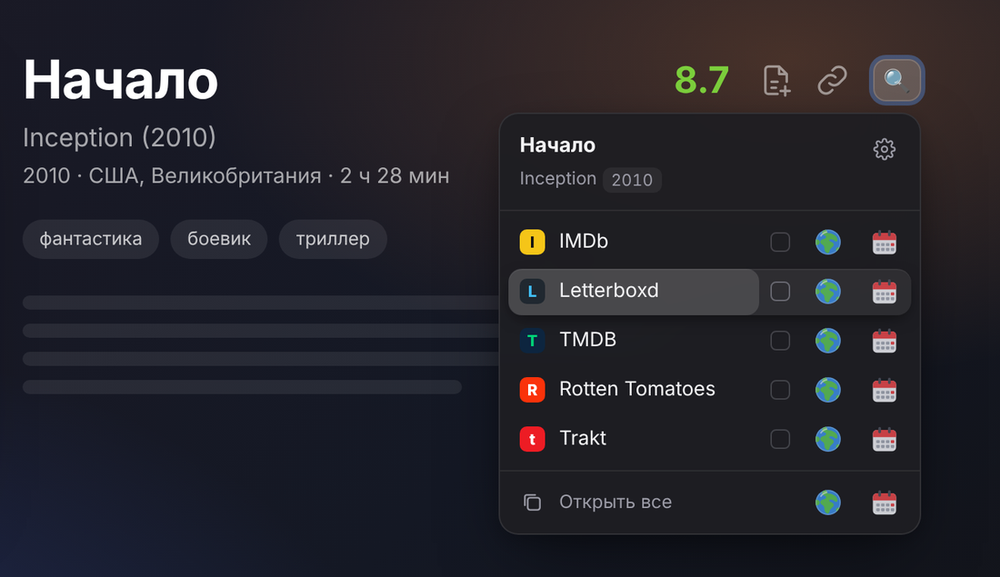
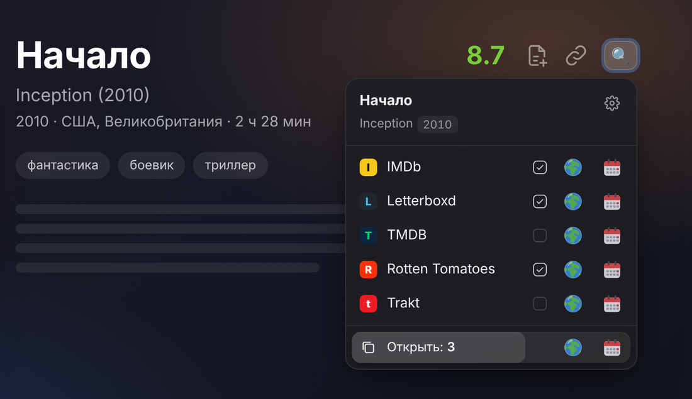
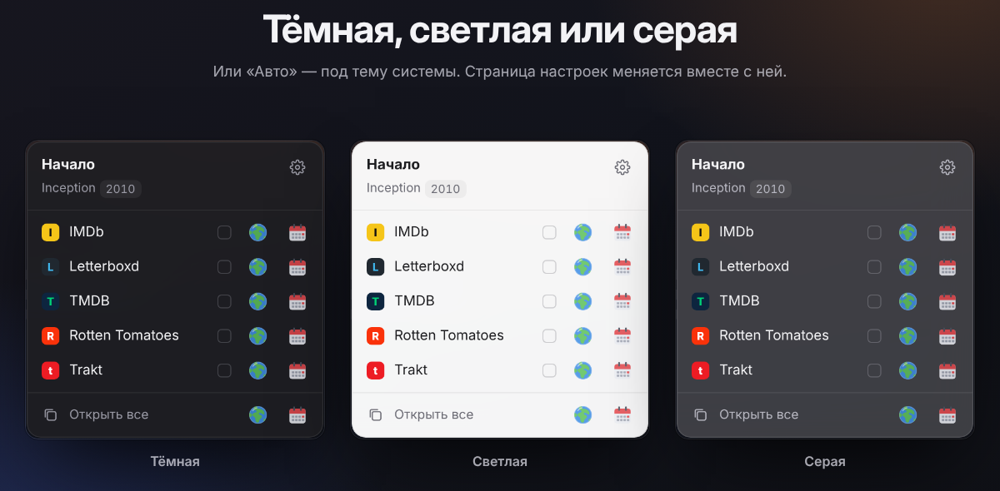
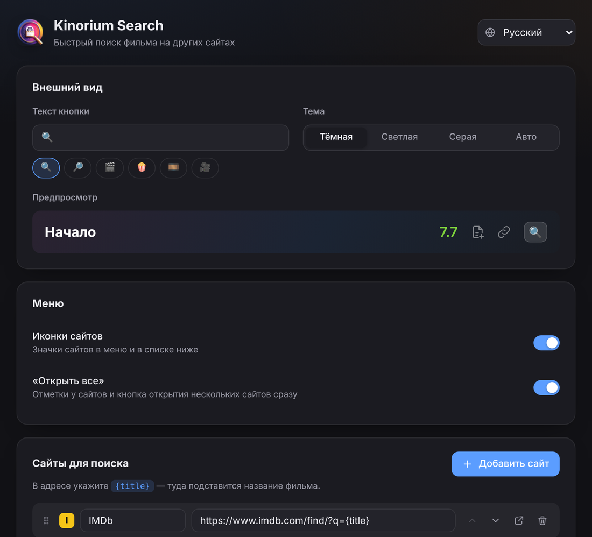
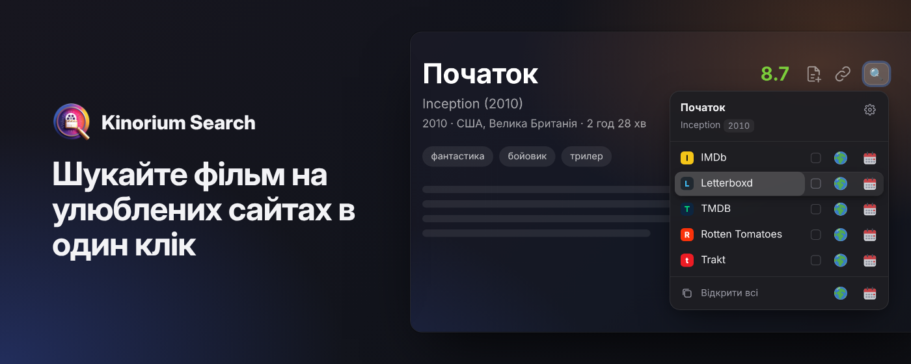
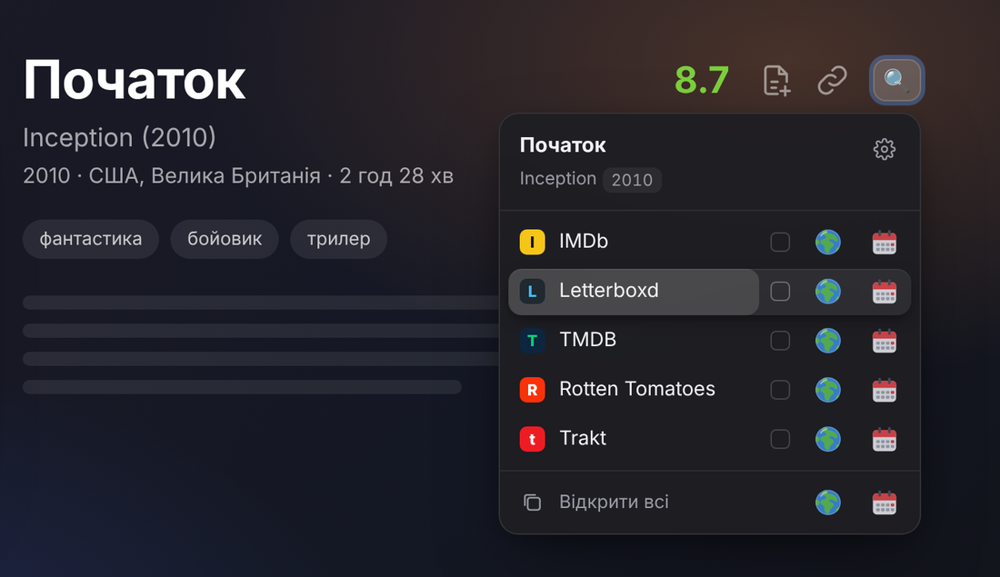
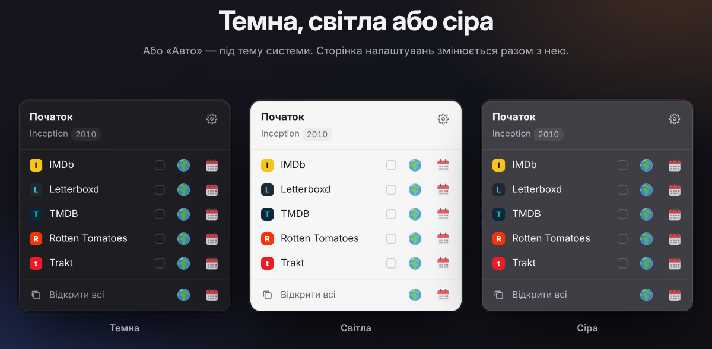
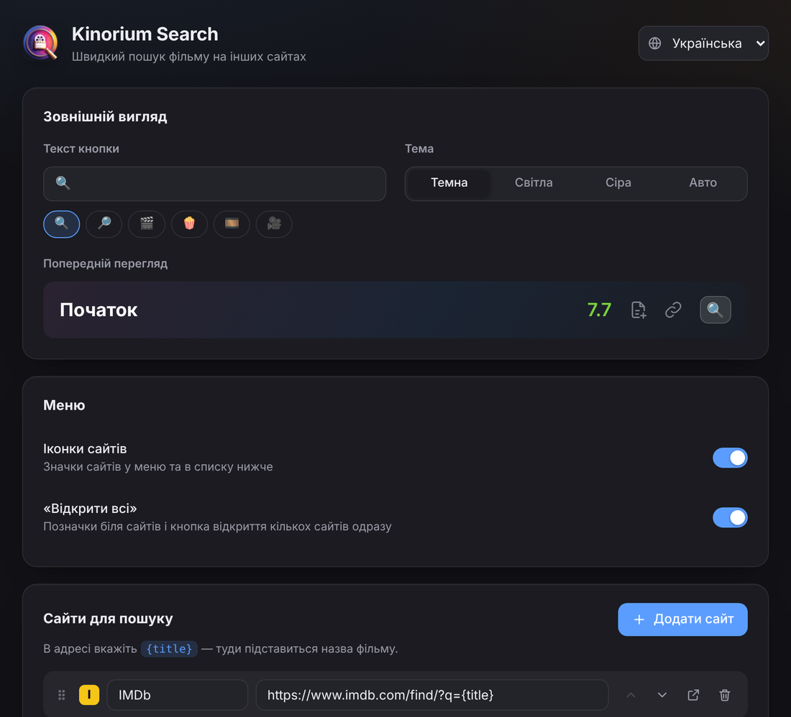

<!--
  After publishing, replace every CHROME_WEB_STORE_URL in README.md, README.ru.md and README.uk.md
  with the store link, e.g. https://chromewebstore.google.com/detail/kinorium-search/<EXTENSION_ID>
  Optional live badges (replace <EXTENSION_ID> and put them next to the Install badge):
  
  
  
-->

  <b>English</b> &nbsp;|&nbsp; <a href="README.ru.md">Русский</a> &nbsp;|&nbsp; <a href="README.uk.md">Українська</a>

  

  

  Find any movie from <b>Kinorium</b> on your favorite sites — in one click.

---

## About

**Kinorium Search** adds a neat search button right next to the movie title on Kinorium film pages. Click it and search the film on IMDb, Letterboxd, TMDB, Rotten Tomatoes or any other site you add — no more copying titles and switching tabs.

## Features

- **Three ways to search**
  - site name — by the title shown on the page;
  - 🌍 — by the original title (best for IMDb, Letterboxd and foreign sites);
  - 📅 — original title + year, for exact matches with remakes and namesakes.
- **Open several sites at once.** Tick the sites you need and open them in background tabs with one click. Nothing ticked — all sites open.
- **Any sites.** Put `{title}` into a search URL, and the site is added. Popular sites can be added in one click.
- **Handy settings.** Drag & drop ordering, a test button for each link, autosave, export and import.
- **Your look.** Dark, light, gray or automatic theme, your own button text or emoji; site icons and “Open all” can be turned off.
- **Three languages.** English, Ukrainian, Russian.
- **Private.** No data collection, no ads, no analytics.

## Screenshots

  
  

  

  

## Installation

### From the Chrome Web Store
Open the [extension page](CHROME_WEB_STORE_URL) and click **Add to Chrome**.

### Manually (developer mode)
1. Download this repository: **Code → Download ZIP**, then unpack it.
2. Open `chrome://extensions` and turn on **Developer mode** (top right).
3. Click **Load unpacked** and select the folder that contains `manifest.json`.

Works in Chrome and other Chromium-based browsers (Edge, Brave, Opera, Vivaldi).

## How to use

1. Open any film page on [Kinorium](https://en.kinorium.com/).
2. Click the 🔍 button next to the title.
3. Pick a site — the search opens in a new tab.

**Tips**
- Middle-click or <kbd>Ctrl</kbd>+click opens a site in a background tab and keeps the menu open.
- Hover over a title in the menu to copy it.
- <kbd>Esc</kbd> closes the menu.
- Click the extension icon in the toolbar to open the settings.

## Adding your own site

1. Search for anything on the site you want.
2. Copy the address of the results page.
3. Replace your query in it with `{title}`.

| Site | URL |
|---|---|
| IMDb | `https://www.imdb.com/find/?q={title}` |
| Letterboxd | `https://letterboxd.com/search/films/{title}/` |
| TMDB | `https://www.themoviedb.org/search?query={title}` |

You don't need to add the year: the 📅 button appends it to the title automatically.

## Permissions

| Permission | Why it's needed |
|---|---|
| `storage` | Save your settings and sync them between your devices |
| `favicon` | Show site icons from Chrome's own cache |
| Access to `ru./ua./en.kinorium.com` | Read the title and year from the film page and add the button |

## Privacy

The extension doesn't collect, send or sell any data. Details: [PRIVACY.md](PRIVACY.md).

## Changelog

### 1.1.0
- New look for the menu and the settings page
- Original title and year shown in the menu, copy in one click
- Open several selected sites at once
- Site icons, gray and automatic themes
- Popular sites in one click, drag & drop, link test, autosave
- Options to hide site icons and “Open all”
- Safer settings import, plus fixes for several bugs

## License

<!-- Add a LICENSE file (for example, MIT) and update this section. -->
See [LICENSE](LICENSE).

---

Kinorium Search is an independent project and is not affiliated with Kinorium.

<!--
  После публикации замените все CHROME_WEB_STORE_URL ссылкой на страницу в магазине.
  Живые бейджи — см. комментарий в начале README.md.
-->

## Русский

  <a href="README.md">English</a> &nbsp;|&nbsp; <b>Русский</b> &nbsp;|&nbsp; <a href="README.uk.md">Українська</a>

  

  

  Ищите фильм с <b>Kinorium</b> на любимых сайтах — в один клик.

---

## О расширении

**Kinorium Search** добавляет аккуратную кнопку поиска рядом с названием на странице фильма в Kinorium. Нажмите её и найдите фильм на IMDb, Letterboxd, TMDB, Rotten Tomatoes или любом другом сайте, который вы добавите. Больше не нужно копировать названия и переключаться между вкладками.

## Возможности

- **Три способа поиска**
  - название сайта — по названию со страницы;
  - 🌍 — по оригинальному названию (лучше всего для IMDb, Letterboxd и зарубежных сайтов);
  - 📅 — оригинальное название + год, для точного совпадения с ремейками и тёзками.
- **Несколько сайтов сразу.** Отметьте нужные сайты и откройте их в фоновых вкладках одним нажатием. Ничего не отмечено — откроются все.
- **Любые сайты.** Укажите `{title}` в адресе поиска, и сайт добавлен. Популярные сайты добавляются в один клик.
- **Удобные настройки.** Порядок меняется перетаскиванием, каждую ссылку можно проверить, всё сохраняется автоматически, есть экспорт и импорт.
- **Внешний вид под вас.** Тёмная, светлая, серая или автоматическая тема, свой текст или эмодзи на кнопке; иконки сайтов и «Открыть все» можно отключить.
- **Три языка.** Русский, украинский, английский.
- **Приватность.** Никакого сбора данных, рекламы и аналитики.

## Скриншоты

  
  

  

  

## Установка

### Из Chrome Web Store
Откройте [страницу расширения](CHROME_WEB_STORE_URL) и нажмите **«Установить»**.

### Вручную (режим разработчика)
1. Скачайте репозиторий: **Code → Download ZIP**, затем распакуйте архив.
2. Откройте `chrome://extensions` и включите **«Режим разработчика»** (справа вверху).
3. Нажмите **«Загрузить распакованное»** и выберите папку с файлом `manifest.json`.

Работает в Chrome и других браузерах на Chromium (Edge, Brave, Opera, Vivaldi).

## Как пользоваться

1. Откройте страницу любого фильма в [Kinorium](https://ru.kinorium.com/).
2. Нажмите кнопку 🔍 рядом с названием.
3. Выберите сайт — поиск откроется в новой вкладке.

**Подсказки**
- Средняя кнопка мыши или <kbd>Ctrl</kbd>+клик открывают сайт в фоновой вкладке, а меню остаётся открытым.
- Наведите на название в меню, чтобы скопировать его.
- <kbd>Esc</kbd> закрывает меню.
- Клик по значку расширения на панели браузера открывает настройки.

## Как добавить свой сайт

1. Поищите что угодно на нужном сайте.
2. Скопируйте адрес страницы с результатами.
3. Замените в нём ваш запрос на `{title}`.

| Сайт | Адрес |
|---|---|
| IMDb | `https://www.imdb.com/find/?q={title}` |
| Letterboxd | `https://letterboxd.com/search/films/{title}/` |
| TMDB | `https://www.themoviedb.org/search?query={title}` |

Год добавлять не нужно: кнопка 📅 сама допишет его к названию.

## Разрешения

| Разрешение | Зачем нужно |
|---|---|
| `storage` | Хранить настройки и синхронизировать их между вашими устройствами |
| `favicon` | Показывать значки сайтов из кэша Chrome |
| Доступ к `ru./ua./en.kinorium.com` | Прочитать название и год на странице фильма и добавить кнопку |

## Конфиденциальность

Расширение не собирает, не передаёт и не продаёт никакие данные. Подробнее: [PRIVACY.md](PRIVACY.md).

## История изменений

### 1.1.0
- Новый дизайн меню и страницы настроек
- В меню видно оригинальное название и год, их можно скопировать
- Открытие нескольких отмеченных сайтов сразу
- Иконки сайтов, серая и автоматическая темы
- Популярные сайты в один клик, перетаскивание, проверка ссылки, автосохранение
- Можно скрыть иконки сайтов и «Открыть все»
- Безопасный импорт настроек и исправление ряда ошибок

## Лицензия

<!-- Добавьте файл LICENSE (например, MIT) и обновите этот раздел. -->
См. [LICENSE](LICENSE).

---

Kinorium Search — независимый проект, не связанный с Kinorium.

<!--
  Після публікації замініть усі CHROME_WEB_STORE_URL посиланням на сторінку в магазині.
  Живі бейджі — див. коментар на початку README.md.
-->

## Українська

  <a href="README.md">English</a> &nbsp;|&nbsp; <a href="README.ru.md">Русский</a> &nbsp;|&nbsp; <b>Українська</b>

  

  

  Шукайте фільм з <b>Kinorium</b> на улюблених сайтах — в один клік.

---

## Про розширення

**Kinorium Search** додає акуратну кнопку пошуку поруч із назвою на сторінці фільму в Kinorium. Натисніть її та знайдіть фільм на IMDb, Letterboxd, TMDB, Rotten Tomatoes або будь-якому іншому сайті, який ви додасте. Більше не потрібно копіювати назви й перемикатися між вкладками.

## Можливості

- **Три способи пошуку**
  - назва сайту — за назвою зі сторінки;
  - 🌍 — за оригінальною назвою (найкраще для IMDb, Letterboxd і закордонних сайтів);
  - 📅 — оригінальна назва + рік, для точного збігу з ремейками та тезками.
- **Кілька сайтів одразу.** Позначте потрібні сайти й відкрийте їх у фонових вкладках одним натисканням. Нічого не позначено — відкриються всі.
- **Будь-які сайти.** Вкажіть `{title}` в адресі пошуку, і сайт додано. Популярні сайти додаються в один клік.
- **Зручні налаштування.** Порядок змінюється перетягуванням, кожне посилання можна перевірити, усе зберігається автоматично, є експорт та імпорт.
- **Вигляд під вас.** Темна, світла, сіра або автоматична тема, власний текст чи емодзі на кнопці; іконки сайтів і «Відкрити всі» можна вимкнути.
- **Три мови.** Українська, російська, англійська.
- **Приватність.** Жодного збору даних, реклами й аналітики.

## Скриншоти

  
  

  

  

## Встановлення

### З Chrome Web Store
Відкрийте [сторінку розширення](CHROME_WEB_STORE_URL) і натисніть **«Встановити»**.

### Вручну (режим розробника)
1. Завантажте репозиторій: **Code → Download ZIP**, потім розпакуйте архів.
2. Відкрийте `chrome://extensions` і ввімкніть **«Режим розробника»** (праворуч угорі).
3. Натисніть **«Завантажити розпаковане»** й оберіть папку з файлом `manifest.json`.

Працює в Chrome та інших браузерах на Chromium (Edge, Brave, Opera, Vivaldi).

## Як користуватися

1. Відкрийте сторінку будь-якого фільму в [Kinorium](https://ua.kinorium.com/).
2. Натисніть кнопку 🔍 поруч із назвою.
3. Оберіть сайт — пошук відкриється в новій вкладці.

**Підказки**
- Середня кнопка миші або <kbd>Ctrl</kbd>+клік відкривають сайт у фоновій вкладці, а меню лишається відкритим.
- Наведіть на назву в меню, щоб скопіювати її.
- <kbd>Esc</kbd> закриває меню.
- Клік по значку розширення на панелі браузера відкриває налаштування.

## Як додати свій сайт

1. Пошукайте будь-що на потрібному сайті.
2. Скопіюйте адресу сторінки з результатами.
3. Замініть у ній ваш запит на `{title}`.

| Сайт | Адреса |
|---|---|
| IMDb | `https://www.imdb.com/find/?q={title}` |
| Letterboxd | `https://letterboxd.com/search/films/{title}/` |
| TMDB | `https://www.themoviedb.org/search?query={title}` |

Рік додавати не потрібно: кнопка 📅 сама допише його до назви.

## Дозволи

| Дозвіл | Навіщо потрібен |
|---|---|
| `storage` | Зберігати налаштування й синхронізувати їх між вашими пристроями |
| `favicon` | Показувати значки сайтів із кешу Chrome |
| Доступ до `ru./ua./en.kinorium.com` | Прочитати назву та рік на сторінці фільму й додати кнопку |

## Конфіденційність

Розширення не збирає, не передає й не продає жодних даних. Докладніше: [PRIVACY.md](PRIVACY.md).

## Історія змін

### 1.1.0
- Новий дизайн меню та сторінки налаштувань
- У меню видно оригінальну назву й рік, їх можна скопіювати
- Відкриття кількох позначених сайтів одразу
- Іконки сайтів, сіра й автоматична теми
- Популярні сайти в один клік, перетягування, перевірка посилання, автозбереження
- Можна приховати іконки сайтів і «Відкрити всі»
- Безпечний імпорт налаштувань і виправлення низки помилок

## Ліцензія

<!-- Додайте файл LICENSE (наприклад, MIT) і оновіть цей розділ. -->
Див. [LICENSE](LICENSE).

---

Kinorium Search — незалежний проєкт, не пов’язаний з Kinorium.
