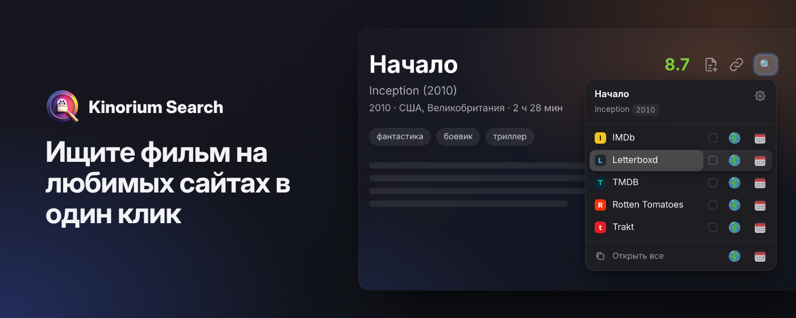
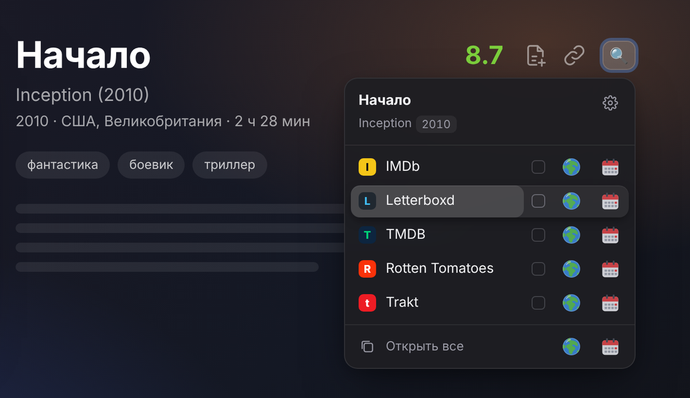
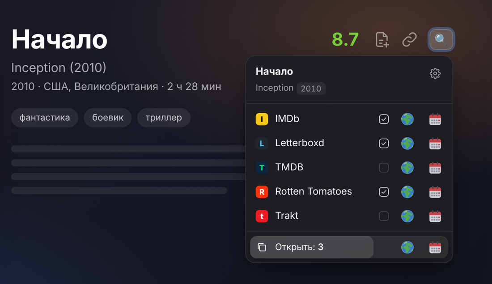
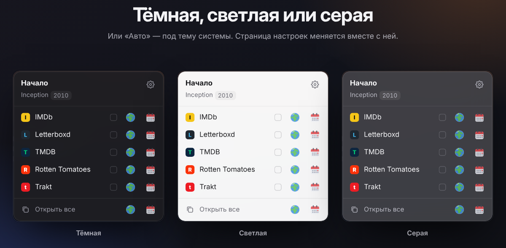
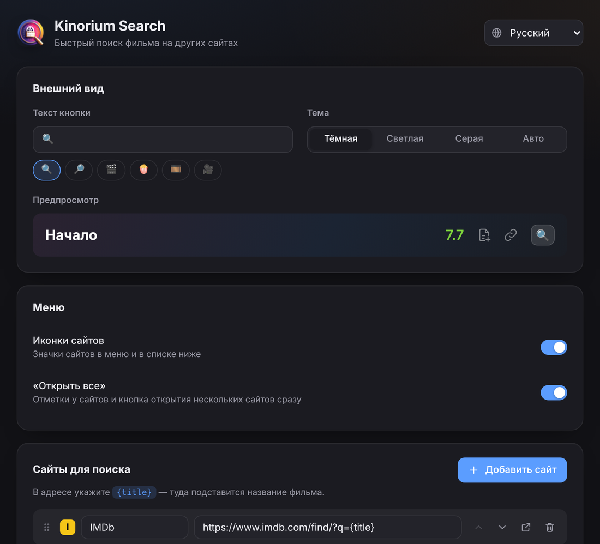

<!--
  После публикации замените все CHROME_WEB_STORE_URL ссылкой на страницу в магазине.
  Живые бейджи — см. комментарий в начале README.md.
-->

  <a href="README.md">English</a> &nbsp;|&nbsp; <b>Русский</b> &nbsp;|&nbsp; <a href="README.uk.md">Українська</a>

  

  

  Ищите фильм с <b>Kinorium</b> на любимых сайтах — в один клик.

---

## О расширении

**Kinorium Search** добавляет аккуратную кнопку поиска рядом с названием на странице фильма в Kinorium. Нажмите её и найдите фильм на IMDb, Letterboxd, TMDB, Rotten Tomatoes или любом другом сайте, который вы добавите. Больше не нужно копировать названия и переключаться между вкладками.

## Возможности

- **Три способа поиска**
  - название сайта — по названию со страницы;
  - 🌍 — по оригинальному названию (лучше всего для IMDb, Letterboxd и зарубежных сайтов);
  - 📅 — оригинальное название + год, для точного совпадения с ремейками и тёзками.
- **Несколько сайтов сразу.** Отметьте нужные сайты и откройте их в фоновых вкладках одним нажатием. Ничего не отмечено — откроются все.
- **Любые сайты.** Укажите `{title}` в адресе поиска, и сайт добавлен. Популярные сайты добавляются в один клик.
- **Удобные настройки.** Порядок меняется перетаскиванием, каждую ссылку можно проверить, всё сохраняется автоматически, есть экспорт и импорт.
- **Внешний вид под вас.** Тёмная, светлая, серая или автоматическая тема, свой текст или эмодзи на кнопке; иконки сайтов и «Открыть все» можно отключить.
- **Три языка.** Русский, украинский, английский.
- **Приватность.** Никакого сбора данных, рекламы и аналитики.

## Скриншоты

  
  

  

  

## Установка

### Из Chrome Web Store
Откройте [страницу расширения](CHROME_WEB_STORE_URL) и нажмите **«Установить»**.

### Вручную (режим разработчика)
1. Скачайте репозиторий: **Code → Download ZIP**, затем распакуйте архив.
2. Откройте `chrome://extensions` и включите **«Режим разработчика»** (справа вверху).
3. Нажмите **«Загрузить распакованное»** и выберите папку с файлом `manifest.json`.

Работает в Chrome и других браузерах на Chromium (Edge, Brave, Opera, Vivaldi).

## Как пользоваться

1. Откройте страницу любого фильма в [Kinorium](https://ru.kinorium.com/).
2. Нажмите кнопку 🔍 рядом с названием.
3. Выберите сайт — поиск откроется в новой вкладке.

**Подсказки**
- Средняя кнопка мыши или <kbd>Ctrl</kbd>+клик открывают сайт в фоновой вкладке, а меню остаётся открытым.
- Наведите на название в меню, чтобы скопировать его.
- <kbd>Esc</kbd> закрывает меню.
- Клик по значку расширения на панели браузера открывает настройки.

## Как добавить свой сайт

1. Поищите что угодно на нужном сайте.
2. Скопируйте адрес страницы с результатами.
3. Замените в нём ваш запрос на `{title}`.

| Сайт | Адрес |
|---|---|
| IMDb | `https://www.imdb.com/find/?q={title}` |
| Letterboxd | `https://letterboxd.com/search/films/{title}/` |
| TMDB | `https://www.themoviedb.org/search?query={title}` |

Год добавлять не нужно: кнопка 📅 сама допишет его к названию.

## Разрешения

| Разрешение | Зачем нужно |
|---|---|
| `storage` | Хранить настройки и синхронизировать их между вашими устройствами |
| `favicon` | Показывать значки сайтов из кэша Chrome |
| Доступ к `ru./ua./en.kinorium.com` | Прочитать название и год на странице фильма и добавить кнопку |

## Конфиденциальность

Расширение не собирает, не передаёт и не продаёт никакие данные. Подробнее: [PRIVACY.md](PRIVACY.md).

## История изменений

### 1.1.0
- Новый дизайн меню и страницы настроек
- В меню видно оригинальное название и год, их можно скопировать
- Открытие нескольких отмеченных сайтов сразу
- Иконки сайтов, серая и автоматическая темы
- Популярные сайты в один клик, перетаскивание, проверка ссылки, автосохранение
- Можно скрыть иконки сайтов и «Открыть все»
- Безопасный импорт настроек и исправление ряда ошибок

## Лицензия

<!-- Добавьте файл LICENSE (например, MIT) и обновите этот раздел. -->
См. [LICENSE](LICENSE).

---

Kinorium Search — независимый проект, не связанный с Kinorium.
