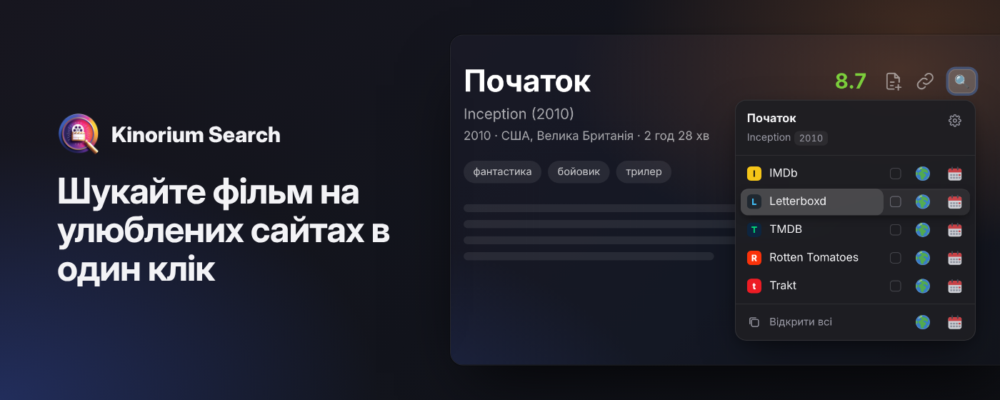
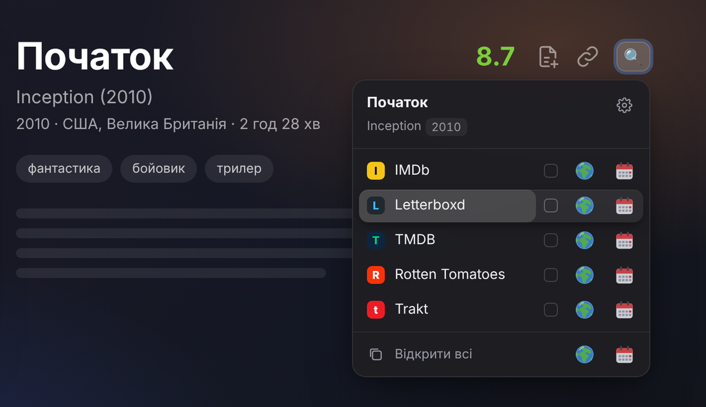
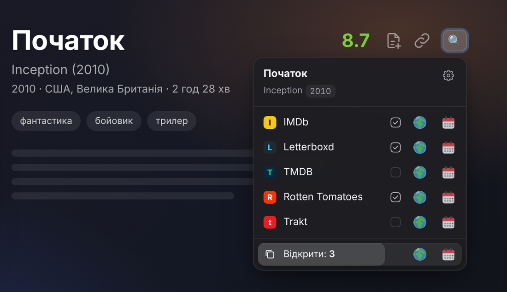
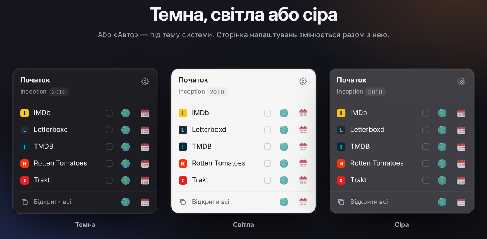
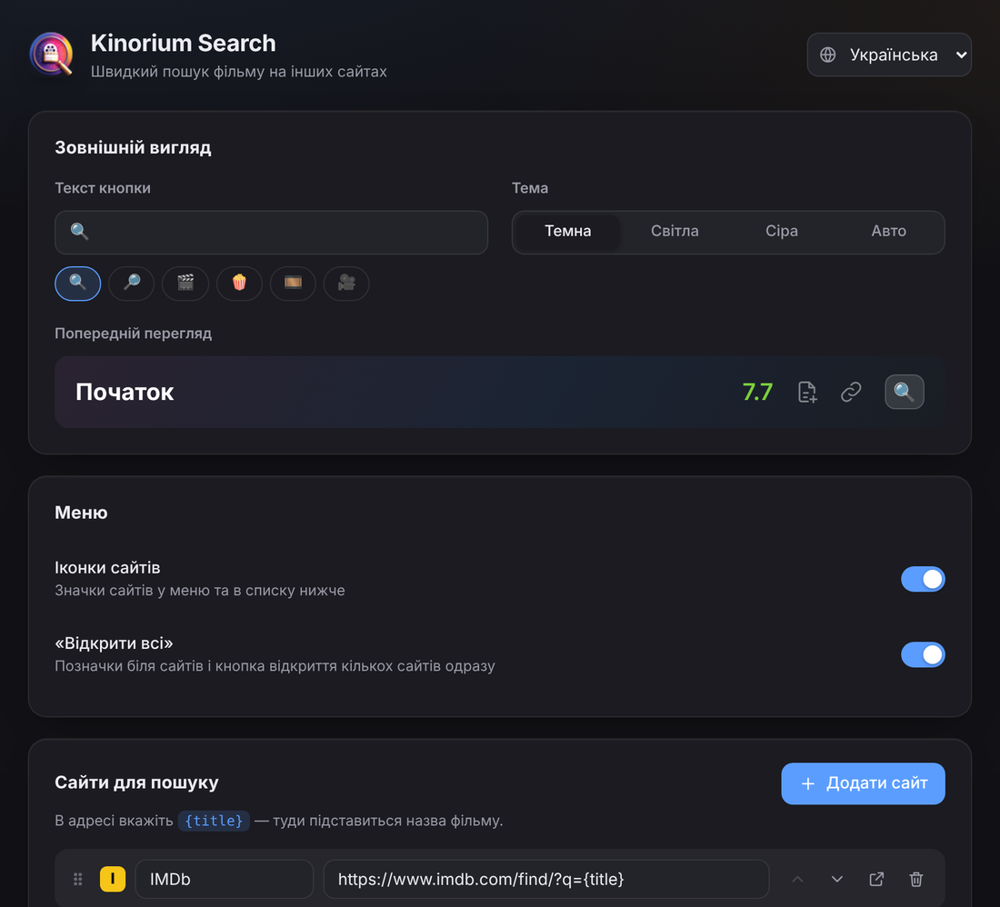

<!--
  Після публікації замініть усі CHROME_WEB_STORE_URL посиланням на сторінку в магазині.
  Живі бейджі — див. коментар на початку README.md.
-->

  

  

  <a href="README.md">English</a> &nbsp;|&nbsp; <a href="README.ru.md">Русский</a> &nbsp;|&nbsp; <b>Українська</b>

  Шукайте фільм з <b>Kinorium</b> на улюблених сайтах — в один клік.

---

## Про розширення

**Kinorium Search** додає акуратну кнопку пошуку поруч із назвою на сторінці фільму в Kinorium. Натисніть її та знайдіть фільм на IMDb, Letterboxd, TMDB, Rotten Tomatoes або будь-якому іншому сайті, який ви додасте. Більше не потрібно копіювати назви й перемикатися між вкладками.

## Можливості

- **Три способи пошуку**
  - назва сайту — за назвою зі сторінки;
  - 🌍 — за оригінальною назвою (найкраще для IMDb, Letterboxd і закордонних сайтів);
  - 📅 — оригінальна назва + рік, для точного збігу з ремейками та тезками.
- **Кілька сайтів одразу.** Позначте потрібні сайти й відкрийте їх у фонових вкладках одним натисканням. Нічого не позначено — відкриються всі.
- **Будь-які сайти.** Вкажіть `{title}` в адресі пошуку, і сайт додано. Популярні сайти додаються в один клік.
- **Зручні налаштування.** Порядок змінюється перетягуванням, кожне посилання можна перевірити, усе зберігається автоматично, є експорт та імпорт.
- **Вигляд під вас.** Темна, світла, сіра або автоматична тема, власний текст чи емодзі на кнопці; іконки сайтів і «Відкрити всі» можна вимкнути.
- **Три мови.** Українська, російська, англійська.
- **Приватність.** Жодного збору даних, реклами й аналітики.

## Скриншоти

  
  

  

  

## Встановлення

### З Chrome Web Store
Відкрийте [сторінку розширення](CHROME_WEB_STORE_URL) і натисніть **«Встановити»**.

### Вручну (режим розробника)
1. Завантажте репозиторій: **Code → Download ZIP**, потім розпакуйте архів.
2. Відкрийте `chrome://extensions` і ввімкніть **«Режим розробника»** (праворуч угорі).
3. Натисніть **«Завантажити розпаковане»** й оберіть папку з файлом `manifest.json`.

Працює в Chrome та інших браузерах на Chromium (Edge, Brave, Opera, Vivaldi).

## Як користуватися

1. Відкрийте сторінку будь-якого фільму в [Kinorium](https://ua.kinorium.com/).
2. Натисніть кнопку 🔍 поруч із назвою.
3. Оберіть сайт — пошук відкриється в новій вкладці.

**Підказки**
- Середня кнопка миші або <kbd>Ctrl</kbd>+клік відкривають сайт у фоновій вкладці, а меню лишається відкритим.
- Наведіть на назву в меню, щоб скопіювати її.
- <kbd>Esc</kbd> закриває меню.
- Клік по значку розширення на панелі браузера відкриває налаштування.

## Як додати свій сайт

1. Пошукайте будь-що на потрібному сайті.
2. Скопіюйте адресу сторінки з результатами.
3. Замініть у ній ваш запит на `{title}`.

| Сайт | Адреса |
|---|---|
| IMDb | `https://www.imdb.com/find/?q={title}` |
| Letterboxd | `https://letterboxd.com/search/films/{title}/` |
| TMDB | `https://www.themoviedb.org/search?query={title}` |

Рік додавати не потрібно: кнопка 📅 сама допише його до назви.

## Дозволи

| Дозвіл | Навіщо потрібен |
|---|---|
| `storage` | Зберігати налаштування й синхронізувати їх між вашими пристроями |
| `favicon` | Показувати значки сайтів із кешу Chrome |
| Доступ до `ru./ua./en.kinorium.com` | Прочитати назву та рік на сторінці фільму й додати кнопку |

## Конфіденційність

Розширення не збирає, не передає й не продає жодних даних. Докладніше: [PRIVACY.md](PRIVACY.md).

## Історія змін

### 1.1.0
- Новий дизайн меню та сторінки налаштувань
- У меню видно оригінальну назву й рік, їх можна скопіювати
- Відкриття кількох позначених сайтів одразу
- Іконки сайтів, сіра й автоматична теми
- Популярні сайти в один клік, перетягування, перевірка посилання, автозбереження
- Можна приховати іконки сайтів і «Відкрити всі»
- Безпечний імпорт налаштувань і виправлення низки помилок

## Ліцензія

<!-- Додайте файл LICENSE (наприклад, MIT) і оновіть цей розділ. -->
Див. [LICENSE](LICENSE).

---

Kinorium Search — незалежний проєкт, не пов’язаний з Kinorium.
